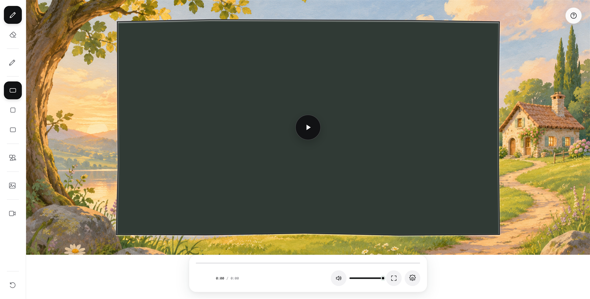

# Forma

<p align="center">
  
</p>

<p align="center">
  <strong>A drawing-led video player where every sketch becomes a screen.</strong><br />
  Transform video playback from a rigid box into a living canvas.
</p>

<p align="center">
  
  
  
  
  
</p>

---

## Overview

**Forma** is an experimental video canvas that breaks out of conventional rectangular viewports. Powered by **Video.js v10 Web Components** and SVG clip paths, Forma lets you sketch custom frame viewports with a pencil, stamp geometric aspects, draw artwork directly onto the canvas, or erase parts of the video stream in real time—all while the video plays smoothly within the live DOM.

Whether you're framing a clip with hand-drawn borders, painting scenic backgrounds, or uploading custom media, Forma bridges video playback with an organic art studio experience.

---

## Key Features

### 🎨 Drawing & Canvas Studio
- **Freehand Frame Pencil (`P`):** Draw any closed contour on the canvas; Forma automatically calculates an SVG `<clipPath>` that shapes the live video playback window.
- **Dual-Layer Eraser (`E`):** Intelligently erase parts of the frame outline, pencil drawings, or the live video itself with adjustable brush size (`8px` to `96px`).
- **Color Pencil Inking:** Sketch and annotate around the video with variable stroke weights and a curated mineral ink palette (Carbon black, Graphite, Slate, Pine, Deep blue, Terracotta, Plum) or custom hex colors.
- **Aspect Ratio Stamps:** Instant one-click stamps for widescreen (`16:9`), square (`1:1`), and vintage (`4:3`) frames.
- **Vector Canvas Shapes:** Draw rectangles, ellipses, triangles, and stars. Select, reposition, and resize shapes on the fly, or fill them with custom colors and variable opacity (`15%`–`100%`).
- **Curated Wallpapers & Custom Backgrounds:** Apply built-in illustrated art backgrounds or upload custom images with selectable fit modes (`cover` / `contain`) and opacity blending.
- **Offline-First Media Storage:** Custom uploaded wallpapers and videos are saved directly in your browser's **IndexedDB**, remaining available across sessions without sending data to any external server.

### 🎬 Next-Gen Video.js v10 Engine
- **Custom Player Element:** Extends Video.js v10's `@videojs/html` base architecture with integrated `liveFeature`, `streamTypeFeature`, and `orientationLockFeature`.
- **Floating Frosted Control Strip:** Elegant glassmorphic player controls with play/pause, time elapsed/duration, mute/volume slider, and fullscreen toggles.
- **Scrubbing & Chapter-Aware Timeline:** High-precision seek slider featuring buffered progress indicators, chapter markers, and interactive hover previews.
- **Comprehensive Playback Settings:**
  - **Quick Seek & Skip:** Instant ±10-second skip buttons and playlist navigation.
  - **Speed Selector:** Fine-grained playback rates (`0.5x`, `0.75x`, `1x`, `1.25x`, `1.5x`, `2x`).
  - **Captions & Subtitles:** Built-in track selector with support for uploading external `.vtt` WebVTT subtitle files.
  - **Chapter Markers:** Interactive chapter timeline cues loaded from standard WebVTT chapter files.
  - **Multi-Track Audio & Renditions:** Dynamic audio track selection and adaptive bitrate video quality options.
  - **External Display & Casting:** Full support for Apple AirPlay, Google Cast, and Picture-in-Picture (PiP).
  - **Screen Orientation Lock:** Lock fullscreen viewports to landscape or portrait on compatible mobile displays.
  - **Privacy-First Analytics:** Opt-in switch for streaming performance telemetry with zero tracking cookies.

---

## Getting Started

### Prerequisites
- [Node.js](https://nodejs.org/) (version 18 or newer recommended)
- `npm`, `pnpm`, or `yarn`

### Quick Start

1. **Clone the repository:**
   ```bash
   git clone https://github.com/sandman-sh/Forma.git
   cd Forma
   ```

2. **Install dependencies:**
   ```bash
   npm install
   ```

3. **Start the local development server:**
   ```bash
   npm run dev
   ```

4. **Open in browser:**  
   Navigate to the local address displayed in your terminal (typically `http://localhost:5173/`).

### Production Build

Compile optimized static assets:

```bash
npm run build
npm run preview
```

The production output is generated in `dist/` and can be served statically by any CDN or web host (e.g. Vercel, Netlify, Cloudflare Pages, GitHub Pages).

---

## Keyboard Shortcuts & Gestures

Forma includes first-class keyboard navigation and touch gesture support:

| Key / Gesture | Action |
| :--- | :--- |
| <kbd>Space</kbd> | Toggle Play / Pause |
| <kbd>M</kbd> | Toggle Mute / Unmute |
| <kbd>F</kbd> | Toggle Fullscreen mode |
| <kbd>←</kbd> / <kbd>→</kbd> | Seek backward / forward 5 seconds |
| <kbd>↑</kbd> / <kbd>↓</kbd> | Increase / decrease volume by 5% |
| <kbd>Shift</kbd> + <kbd>←</kbd> / <kbd>→</kbd> | Decrease / increase playback speed |
| <kbd>0</kbd> – <kbd>9</kbd> | Seek to 0% – 90% of the video duration |
| <kbd>P</kbd> | Select Frame Pencil tool |
| <kbd>E</kbd> | Select Eraser tool |
| **Touch Double-Tap (Left / Right)** | Skip backward / forward 10 seconds |
| **Touch Double-Tap (Center)** | Toggle Play / Pause |

---

## Technical Architecture

```
Forma Architecture
│
├── Studio Layer (DOM)
│   ├── Tool Rail (Drawing, Eraser, Shapes, Inks, Wallpapers, Media)
│   └── Canvas Surface & Floating Controls
│
├── Video Viewport Layer
│   ├── Background Wallpaper Layer (Local IndexedDB / Built-in assets)
│   ├── Live Video (<mux-video> within <forma-player>)
│   ├── SVG Clip-Path Masking (<clipPath clipPathUnits="objectBoundingBox">)
│   └── Luminance Erase Masks (Video, Artwork, Outline)
│
└── Vector Artwork Layer
    ├── Drawn Vector Art (<g id="drawn-art">)
    └── Dynamic Shape Manipulators (<g id="shape-selection-layer">)
```

### 1. Dynamic SVG Clip-Paths
Unlike conventional canvas players that redraw video frames onto a `<canvas>` element at 30/60fps (incurring heavy CPU/GPU overhead), Forma keeps the actual `<mux-video>` element in the DOM. User sketches are converted into an SVG `<path>` and bound to a dynamic `<clipPath>` with `clipPathUnits="objectBoundingBox"`, providing GPU-accelerated video rendering at full native display refresh rates.

### 2. Dual-Layer Luminance Masking
Forma uses SVG luminance masks to enable real-time erasing across distinct layers:
- `#video-erase-mask`: Erases visible areas of the video stream.
- `#art-erase-mask`: Erases hand-drawn pencil artwork.
- `#outline-erase-mask`: Erases the frame's perimeter stroke.

### 3. Client-Side Offline Storage
All custom media—including user-uploaded background wallpapers and external video files—are saved client-side using browser **IndexedDB** databases. Nothing leaves your browser, ensuring privacy and offline persistence.

---

## Media & Streaming Configuration

- **Built-in HLS Streaming:** Forma includes pre-configured streaming samples that showcase adaptive bitrate streaming, storyboard seek thumbnails, and WebVTT support.
- **Local Video Files:** Click **Add videos** in the Video palette to load videos directly from your local file system. Files are indexed locally and remain available across page reloads.
- **Custom HLS Streams:** Forma's Mux Video component natively supports custom HLS streams. Environment variable overrides can be set in a local configuration if connecting to dedicated streaming endpoints.

---

## Contributing

Contributions, feedback, and ideas are warmly welcomed!
1. Fork the repository.
2. Create your feature branch (`git checkout -b feature/creative-brush`).
3. Commit your changes (`git commit -m 'Add creative brush tool'`).
4. Push to the branch (`git push origin feature/creative-brush`).
5. Open a Pull Request.

---

## License

This project is licensed under the [MIT License](LICENSE).
